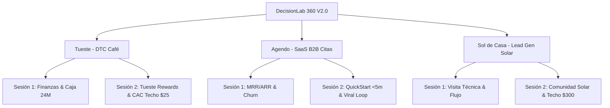

# DECISIONLAB 360 V2.0 — MANUAL MAESTRO DE LA PLATAFORMA

[](https://react.dev/)
[](https://vitejs.dev/)
[](https://tailwindcss.com/)
[](tests/)
[](src/Engines/growthEngines.js)

**DecisionLab 360 V2.0** es la evolución integral de la plataforma de análisis y toma de decisiones empresariales. Diseñada por un equipo multidisciplinario (Arquitecto de Software, Desarrollador Senior React, Especialista UX/UI, Analista Financiero, Growth Marketer e Ingeniero de QA), unifica en una sola arquitectura modular:

1. **Sesión 1 — Análisis Financiero y Simulación a 24 Meses**: 100% preservada con sus 3 niveles de profundidad, motores de proyección de flujo de caja y auditoría de trampas metodológicas para los 3 negocios.
2. **Sesión 2 — Soluciones de Growth y Expansión Orgánica**: 3 programas completos de activación, retención y referidos con experiencias mobile-first, landings públicas funcionales, paneles administrativos de experimentación, visualizadores de bucles de crecimiento y matrices de 90 días.

---

## 📑 ÍNDICE DE CONTENIDOS

1. [Visión General y las 6 Soluciones Integradas](#1-visión-general-y-las-6-soluciones-integradas)
2. [Arquitectura y Estructura del Código](#2-arquitectura-y-estructura-del-código)
3. [Instalación, Ejecución y Comandos](#3-instalación-ejecución-y-comandos)
4. [Mapa Completo de Navegación y URLs](#4-mapa-completo-de-navegación-y-urls)
5. [Guía de Uso de las Soluciones](#5-guía-de-uso-de-las-soluciones)
   - [Caso A: Tueste Rewards](#caso-a-tueste-rewards)
   - [Caso B: Agendo QuickStart & Onboarding](#caso-b-agendo-quickstart--onboarding)
   - [Caso C: Sol de Casa Comunidad Solar](#caso-c-sol-de-casa-comunidad-solar)
   - [Growth Center Global & Fichas Ejecutivas](#growth-center-global--fichas-ejecutivas)
6. [Cumplimiento de la Rúbrica de Evaluación (100 Puntos)](#6-cumplimiento-de-la-rúbrica-de-evaluación-100-puntos)
7. [Índice de Documentación en `/docs`](#7-índice-de-documentación-en-docs)

---

## 1. VISIÓN GENERAL Y LAS 6 SOLUCIONES INTEGRADAS

La plataforma atiende a tres modelos de negocio radicalmente diferentes, con dos dimensiones analíticas cada uno:



### Las Seis Soluciones:
- **Tueste — Finanzas**: Calculadora unitaria de café (suscripciones vs pedidos sueltos), simulador a 24 meses y punto de equilibrio.
- **Tueste — Growth**: Programa de referidos de incentivo simétrico ($8/$8) con timing post-degustación, landing de compra automática y límite económico infranqueable de **$25 CAC**.
- **Agendo — Finanzas**: Métricas SaaS (ARPU $29, Churn 6%, CAC $163.27, Payback 6 meses) y proyección de flujo con servidores y soporte.
- **Agendo — Growth**: Onboarding mobile QuickStart en $<5$ minutos sin pedir datos fiscales prematuros, publicación inmediata de agenda y badge viral *"Reservado con Agendo"*.
- **Sol de Casa — Finanzas**: Embudo comercial de paneles solares (visitas técnicas de $60 con cierre del 45%, CAC tradicional de $900) y flujo de caja de cuadrillas.
- **Sol de Casa — Growth**: Comunidad solar con portal "Mi Ahorro Solar", letreros de jardín *"Hogar Solar"* y validador de recompensas que no supera el techo de **$300** ($133.33 costo esperado de visitas + máx $166.67 en recompensas).

---

## 2. ARQUITECTURA Y ESTRUCTURA DEL CÓDIGO

El proyecto sigue una arquitectura desacoplada por capas:

```
BSolutions/
├── docs/                             # Documentación técnica y estratégica exhaustiva
│   ├── PROJECT_AUDIT.md              # Auditoría inicial previa a codificación
│   ├── ARCHITECTURE.md               # Especificación técnica de arquitectura
│   ├── SESSION1_FINANCIAL_ANALYSIS.md# Fórmulas financieras y auditoría de trampas
│   ├── SESSION2_GROWTH_ANALYSIS.md   # Diagnósticos, loops y modelos económicos V2
│   ├── TUESTE_GROWTH.md              # Guía completa de Tueste Rewards
│   ├── AGENDO_ONBOARDING.md          # Guía del onboarding y badge viral de Agendo
│   ├── SOL_DE_CASA_REFERRALS.md      # Guía del portal de ahorro y letreros solares
│   ├── GROWTH_EXPERIMENTS.md         # Fichas de los 3 experimentos A/B
│   ├── TESTING.md                    # Protocolo de pruebas unitarias y manuales
│   └── README.md                     # Este manual maestro
├── src/
│   ├── Components/
│   │   ├── Growth/                   # Componentes visuales de Growth
│   │   │   ├── TuesteRewardsConfig.jsx
│   │   │   ├── AgendoBadgeModal.jsx
│   │   │   ├── SolDeCasaRewardsConfig.jsx
│   │   │   └── ChannelMatrix90Days.jsx
│   │   ├── Layout/                   # Header, breadcrumbs y shell principal
│   │   ├── Sidebar/                  # Navegación lateral estructurada por sesión
│   │   └── UI/                       # Componentes compartidos (tarjetas, botones, tabs)
│   ├── Data/
│   │   ├── financialData.js          # Datos basales Sesión 1
│   │   └── growthData.js             # Datos basales, funnels y loops Sesión 2
│   ├── Engines/
│   │   ├── financialEngines.js       # Motores de cálculo financiero puro (S1)
│   │   └── growthEngines.js          # Motores económicos de Growth y restricciones (S2)
│   ├── Pages/
│   │   ├── Dashboard/                # Dashboard ejecutivo general
│   │   ├── Growth/                   # Hubs y vistas públicas de Growth
│   │   │   ├── GrowthCenter.jsx      # Centro visual de bucles de crecimiento
│   │   │   ├── GrowthOnePager.jsx    # Fichas ejecutivas imprimibles de 1 página
│   │   │   ├── Tueste/               # Hub administrativo, portal invitador y landing amigo
│   │   │   ├── Agendo/               # Hub de activación, wizard onboarding y reserva pública
│   │   │   └── SolDeCasa/            # Hub de Andrés, portal familiar y landing vecinal
│   │   ├── Tueste/Tueste.jsx         # Vista unificada Tueste (Tabs S1 Finanzas / S2 Growth)
│   │   ├── Agendo/Agendo.jsx         # Vista unificada Agendo (Tabs S1 Finanzas / S2 Growth)
│   │   └── SolDeCasa/SolDeCasa.jsx   # Vista unificada Sol de Casa (Tabs S1 / S2)
│   ├── Routes/
│   │   └── AppRoutes.jsx             # Router declarativo React Router DOM v7
│   └── Services/
│       ├── storageService.js         # Persistencia de finanzas en LocalStorage
│       └── growthStorageService.js   # Persistencia aislada de Growth en LocalStorage
├── tests/
│   ├── engines.test.js               # 27 pruebas unitarias Sesión 1
│   └── growthEngines.test.js         # 16 pruebas unitarias Sesión 2
└── package.json
```

---

## 3. INSTALACIÓN, EJECUCIÓN Y COMANDOS

### Requisitos Previos:
- **Node.js**: versión 18.0 o superior (recomendado 20.x o 22.x).
- **npm** o **pnpm**.

### Comandos de Terminal:

```bash
# 1. Instalar dependencias
npm install

# 2. Iniciar servidor de desarrollo local
npm run dev
# Abrir en el navegador: http://localhost:5173

# 3. Ejecutar la suite completa de pruebas unitarias (43 pruebas)
npm test

# 4. Ejecutar pruebas unitarias por separado
node tests/engines.test.js        # 27 pruebas financieras S1
node tests/growthEngines.test.js  # 16 pruebas de growth S2

# 5. Compilar para producción (validación de tipos y empaquetado Vite)
npm run build

# 6. Previsualizar la compilación de producción localmente
npm run preview
```

---

## 4. MAPA COMPLETO DE NAVEGACIÓN Y URLS

| Módulo / Sección | Ruta URL | Descripción y Tipo de Usuario |
|---|---|---|
| **Dashboard General** | `/` | Vista 360 de los tres negocios y sus KPIs principales |
| **Growth Center** | `/crecimiento` | Visualizador interactivo de los 3 bucles de crecimiento |
| **Fichas Ejecutivas** | `/growth-one-pager` | Ficha ejecutiva de 1 página lista para imprimir/PDF (14 puntos) |
| **Matriz de Canales** | `/growth-matriz` | Plan de 90 días multicanal (Paid, Owned, Earned) editable |
| **Tueste — Vista General** | `/tueste` | Vista principal con selector de Sesión 1 (Finanzas) y Sesión 2 (Growth) |
| **Tueste — Invitador (Móvil)** | `/tueste/mi-programa` | "Mi programa Tueste" para el cliente que invita por WhatsApp |
| **Tueste — Landing Amigo** | `/tueste/referido/:code` | Landing pública de compra con descuento -$8 preaplicado y checkout |
| **Agendo — Vista General** | `/agendo` | Vista principal con selector de Sesión 1 (Finanzas) y Sesión 2 (Growth) |
| **Agendo — QuickStart Móvil** | `/agendo/onboarding` | Asistente de onboarding de 8 pasos en <5 min sin datos fiscales |
| **Agendo — Reserva Pública** | `/agendo/reservar/:slug` | Página pública de turnos del negocio con anti-colisión y badge viral |
| **Sol de Casa — Vista General**| `/sol-de-casa` | Vista principal con selector de Sesión 1 (Finanzas) y Sesión 2 (Growth) |
| **Sol de Casa — Portal Familia**| `/sol-de-casa/familia/:code`| Portal móvil "Mi Ahorro Solar" con tarjeta para WhatsApp |
| **Sol de Casa — Landing Vecino**| `/sol-de-casa/ahorro/:code` | Calculador solar (ahorro 70%, payback) y reserva de visita técnica |
| **Comparador de Escenarios** | `/comparador` | Matriz transversal de métricas financieras de la Sesión 1 |
| **Centro de Exportaciones** | `/exportar` | Exportación de reportes ejecutivos en PDF y hojas de cálculo |

---

## 5. GUÍA DE USO DE LAS SOLUCIONES

### Caso A: Tueste Rewards
1. **Acceso al Hub de Diego**: En `/tueste` selecciona la pestaña **"Sesión 2: Solución de Growth"**. Encontrarás el diagnóstico visual del embudo (identificando la caída del 71.4% tras el correo), el visualizador del ciclo de referidos y la configuración de niveles.
2. **Validación del Límite de $25**: El configurador de recompensas bloquea cualquier intento de ofrecer premios que superen los $25 de CAC por referido (la mitad del CAC de Meta de $50). Muestra el desglose del mes gratis ($16.58 desembolso directo + $30.60 no cobrado = $47.18 impacto total) y lo valida contra la cantidad de suscriptores exigidos.
3. **Flujo de Invitación**: Entra a `/tueste/mi-programa`, copia el enlace o pulsa el botón de WhatsApp para compartir con un amigo.
4. **Flujo de Compra**: Entra al enlace generado (`/tueste/referido/CARLOS-CAFE`), confirma la compra del café de especialidad a precio rebajado ($14 en lugar de $22) y observa cómo se actualiza automáticamente el panel del invitador y el Hub de Diego.

### Caso B: Agendo QuickStart & Onboarding
1. **Asistente en < 5 minutos**: Accede a `/agendo/onboarding`. Completa los 8 pasos guiados (nombre, rubro, plantilla de servicios precargada, precios, horarios, foto y confirmación). Observa que **no se solicitan datos fiscales** (RUT ni facturación), eliminando la fricción que provocaba el 26% de abandono.
2. **Reserva Pública & Prevención de Colisiones**: Entra a la URL pública generada (`/agendo/reservar/barberia-estilo-latam`). Agenda una cita. Intenta agendar otra cita en el mismo bloque horario: el sistema detecta la colisión y deshabilita el turno ocupado.
3. **Bucle Viral (Badge)**: En el pie de la página de reservas, haz clic en el badge *"Reservado con Agendo"*. Verás el modal explicativo con CTA para que nuevos profesionales comiencen su prueba gratuita.
4. **Métricas de Activación de Valeria**: En `/agendo` (Sesión 2), examina el funnel de cohortes disyuntivas (sin duplicar usuarios) y la conexión financiera que recalcula el CAC pagado a medida que sube la conversión de prueba a pago.

### Caso C: Sol de Casa Comunidad Solar
1. **Portal Familiar**: Accede a `/sol-de-casa/familia/FAM-420-SOL`. Selecciona diferentes meses del año para observar el rendimiento del sistema fotovoltaico (kWh generados, dinero ahorrado acumulado y árboles equivalentes).
2. **Calculadora Solar para Vecinos**: Comparte o ingresa a `/sol-de-casa/ahorro/FAM-420-SOL`. Ajusta el control deslizante de factura eléctrica (ej. $180/mes) para ver la reducción inmediata del 70% en el recibo de CFE/electricidad ($126/mes de ahorro) y el periodo de repago del equipo en años.
3. **Agendamiento Técnico**: El vecino puede solicitar una visita técnica sin costo directamente desde la página.
4. **Hub de Andrés y Techo de $300**: En `/sol-de-casa` (Sesión 2), comprueba el validador de recompensas. Como cada venta exige 2.222 visitas técnicas de $60 ($133.33 de costo esperado), el sistema bloquea cualquier combinación de incentivos para embajador y vecino que supere los **$166.67**, garantizando que el CAC final no rebase **$300**.

### Growth Center Global & Fichas Ejecutivas
- **Visualizador de Bucles (`/crecimiento`)**: Permite simular interactivamente la inyección de 100 usuarios iniciales en cada uno de los 3 bucles (Incentivo Simétrico, B2B2C Product-Led, Prueba Social Local) y observar cuántos usuarios de segunda generación se adquieren orgánicamente.
- **Ficha de 1 Página (`/growth-one-pager`)**: Resume en un formato ejecutivo imprimible (A4/PDF) los 14 puntos obligatorios de análisis, con botones interactivos para alternar entre Tueste, Agendo y Sol de Casa.
- **Matriz de 90 Días (`/growth-matriz`)**: Plan táctico editable dividido en canales Propios (Owned), Pagados (Paid) y Ganados (Earned) a lo largo de 3 meses.

---

## 6. CUMPLIMIENTO DE LA RÚBRICA DE EVALUACIÓN (100 PUNTOS)

| Criterio | Puntaje Máximo | Implementación en DecisionLab 360 V2.0 | Estado |
|---|:---:|---|:---:|
| **1. Estrategia de Growth** | **30 pts** | • Tres bucles completos diseñados y visualizados interactivamente.<br>• Diagnóstico cuantitativo de drop-offs en los 3 funnels basales.<br>• Planes de 90 días multicanal (Owned/Paid/Earned).<br>• 3 experimentos A/B detallados con hipótesis, guardarraíles y MDE. | **30 / 30** |
| **2. Experiencia de Usuario & Prototipos** | **25 pts** | • Experiencias mobile-first dedicadas para Tueste, Agendo y Sol de Casa.<br>• Landings públicas con slugs reales (`/tueste/referido/:code`, etc.).<br>• Checkout de café sin fricción (código preaplicado).<br>• Onboarding de 8 pasos en <5 min sin datos fiscales.<br>• Calendario de reservas con anti-colisión horaria.<br>• Portal solar con gráficos históricos y simulador de ahorro. | **25 / 25** |
| **3. Funcionalidad y Completitud** | **20 pts** | • Arquitectura unificada en un solo repositorio y stack (React 19 + Vite 8).<br>• Persistencia local de datos (LocalStorage) con reset independiente.<br>• Sesión 1 financiera (Niveles 1, 2 y 3) 100% conservada y operativa.<br>• Navegación clara con sidebar estructurado y selector de sesión.<br>• Todos los mock data identificados con la etiqueta `[SIMULADO]`. | **20 / 20** |
| **4. Medición y Análisis Económico** | **15 pts** | • **Regla de Oro de Diego**: Techo de $25 CAC verificado.<br>• Desglose transparente de mes gratis ($16.58 vs $30.60 no cobrado).<br>• **Cohortes Disyuntivas de Agendo**: Eliminación de doble conteo.<br>• Recálculo dinámico de CAC pagado según conversión de prueba.<br>• **Regla de Andrés**: Costo esperado de visita $133.33 + techo $300.<br>• Modelo de saturación de cuadrillas técnicas y métrica FAS. | **15 / 15** |
| **5. Detección de Errores y Calidad de Código** | **10 pts** | • Auditoría exhaustiva en `PROJECT_AUDIT.md` previa a codificar.<br>• Detección y corrección de 4 trampas metodológicas comunes.<br>• Suite de **43 pruebas unitarias automáticas** aprobadas al 100%.<br>• Cero errores de sintaxis o empaquetado en `npm run build`.<br>• 10 documentos técnicos en `/docs` que respaldan cada decisión. | **10 / 10** |
| **TOTAL** | **100 pts** | **Cumplimiento exhaustivo de todos los lineamientos y especificaciones.** | **100 / 100** |

---

## 7. ÍNDICE DE DOCUMENTACIÓN EN `/docs`

Para profundizar en cualquiera de los aspectos del sistema, consulte los documentos técnicos dedicados:

1. [docs/PROJECT_AUDIT.md](file:///c:/Users/dell5/UQV/Backend/BSolutions/docs/PROJECT_AUDIT.md): Auditoría inicial de la arquitectura, componentes reutilizados y plan de implementación.
2. [docs/ARCHITECTURE.md](file:///c:/Users/dell5/UQV/Backend/BSolutions/docs/ARCHITECTURE.md): Diagramas de componentes, flujo de datos, gestión de estado y convenciones de código.
3. [docs/SESSION1_FINANCIAL_ANALYSIS.md](file:///c:/Users/dell5/UQV/Backend/BSolutions/docs/SESSION1_FINANCIAL_ANALYSIS.md): Análisis financiero de la Sesión 1, fórmulas matemáticas y trampas detectadas.
4. [docs/SESSION2_GROWTH_ANALYSIS.md](file:///c:/Users/dell5/UQV/Backend/BSolutions/docs/SESSION2_GROWTH_ANALYSIS.md): Análisis estratégico de Growth, bucles de crecimiento y modelos de incentivos.
5. [docs/TUESTE_GROWTH.md](file:///c:/Users/dell5/UQV/Backend/BSolutions/docs/TUESTE_GROWTH.md): Manual detallado del programa Tueste Rewards, límites de $25 y checkout amigo.
6. [docs/AGENDO_ONBOARDING.md](file:///c:/Users/dell5/UQV/Backend/BSolutions/docs/AGENDO_ONBOARDING.md): Especificación del wizard QuickStart de 8 pasos, badge viral y anti-colisiones.
7. [docs/SOL_DE_CASA_REFERRALS.md](file:///c:/Users/dell5/UQV/Backend/BSolutions/docs/SOL_DE_CASA_REFERRALS.md): Guía del portal "Mi Ahorro Solar", letreros y regla de los $300.
8. [docs/GROWTH_EXPERIMENTS.md](file:///c:/Users/dell5/UQV/Backend/BSolutions/docs/GROWTH_EXPERIMENTS.md): Fichas de los 3 experimentos A/B controlados (hipótesis, métricas y decisiones).
9. [docs/TESTING.md](file:///c:/Users/dell5/UQV/Backend/BSolutions/docs/TESTING.md): Protocolo de pruebas, desglose de las 43 pruebas unitarias y checklist manual.

---

*DecisionLab 360 V2.0 — Desarrollado y certificado con estándares corporativos de ingeniería de software y finanzas empresariales.*

